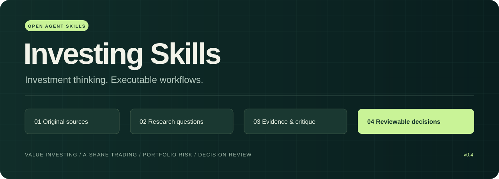

<p align="center">
  
</p>

<h1 align="center">Investing Skills · 投资方法论技能库</h1>

<p align="center"><strong>从巴菲特、炒股养家到缠论打板，认真研究，也能整点活。</strong></p>
<p align="center">47 个 Skills · 社区人物 · 交易流派 · 原创梗股学 · 可追溯出处</p>
<p align="center"><a href="README.en.md">English</a> · <a href="#快速开始">快速开始</a> · <a href="#技能目录">技能目录</a> · <a href="examples/README.md">看示例</a> · <a href="CONTRIBUTING.md">参与共建</a></p>

<p align="center">
  <a href="https://github.com/superShen0916/investing-skills/actions/workflows/validate.yml"></a>
  <a href="LICENSE"></a>
  <a href="https://agentskills.io/specification"></a>
</p>

问 AI“这只股票怎么样”，容易得到一份面面俱到、难以核查的回答。

**把你想采用的研究方法也交给它。**

```text
用段永平框架检查我是不是真的懂这门生意，再用邱国鹭框架审查竞争与估值。
用巴菲特框架研究这家公司的现金创造能力，找出最脆弱的估值假设。
用退学炒股的公开经验复盘这份日志：我为什么在连续赚钱后偏离计划？
用炒股养家的阶段框架分析这份盘面材料，同时保留另一种解释。
```

本库把分散在股东信、机构文章和本人原帖里的公开观点，整理成
**输入 → 取证 → 判断 → 反证 → 输出**的 Agent Skills。每个技能附来源、适用条件和失效情形。

```bash
npx skills add superShen0916/investing-skills
```

## 先选一种打开方式

| 想怎么玩 | 从这里开始 | 例子 |
| --- | --- | --- |
| 跟社区人物学研究与复盘 | [社区人物地图](docs/COMMUNITY_MAP.md) | 退学炒股、北京炒家、赵老哥、asking、瑞鹤仙、陈小群、唐朝、E大等 |
| 跟雪球社区做企业、基金与量化研究 | [雪球研究包](docs/PLAYBOOKS.md#10-雪球社区财报基金与量化) | 唐朝、望京博格、持有封基、银行螺丝钉、E大 |
| 直接按战法学 | [交易流派包](docs/PLAYBOOKS.md#8-交易流派) | 缠论、打板、龙头接力、低吸、趋势突破、网格 |
| 先整点活，再看哪里不对 | [梗股学演示](examples/meme-clinic.md) | 峰哥式退市又上车、户晨风品牌梗、孙宇晨热搜梗 |

> **原创娱乐示例：**“上午的我负责清仓，下午的我负责给上午的我提供流动性。”
>
> 段子归段子；要研究这笔交易，仍需当时计划、成交与退出条件。以上不是人物原话。

## 你想完成什么任务？

| 从这里开始 | 适合的材料 | 可选框架 | 拿到什么 |
| --- | --- | --- | --- |
| [研究一家公司](docs/PLAYBOOKS.md#1-企业研究) | 财报、产品观察、当前论点 | 林奇 → 巴菲特 → 格雷厄姆 → 芒格 | 经营假设、现金与价格、最强反方 |
| [复盘一次交易](docs/PLAYBOOKS.md#2-a-股交易复盘) | 事前计划、候选、成交与费用 | 养家 → 北京炒家 → 退学炒股 | 环境假设、交易事件链、执行偏离 |
| [审查一个组合](docs/PLAYBOOKS.md#3-组合审查) | 匿名持仓、权重、币种、期限 | 博格 → 达利欧 → 马克斯 | 成本账、共同暴露与损失路径 |
| [拆解一个热门叙事](docs/PLAYBOOKS.md#4-市场叙事) | 消息、价格、融资或经营证据 | 索罗斯 → 马克斯 → 养家 | 反馈链、竞争解释与断点 |
| [审查中国企业与逆向论点](docs/PLAYBOOKS.md#5-中国企业质量与逆向研究) | 生意理解、竞争数据、负面事实与现金 | 段永平 → 邱国鹭 → 冯柳 → 张坤 | 理解边界、价值陷阱与股东所得 |
| [交叉检查成长与趋势](docs/PLAYBOOKS.md#6-成长与趋势交叉检查) | 产品线索、调研材料、长期投入与价量 | 林奇 → 费雪 → 张磊 → 欧奈尔 | 成长机制、证据冲突与成交限制 |

按问题加载必要步骤，不要求每次运行整个组合。每条工作流都提供安装命令与可复制提示。
第一次用，可以直接填 [研究输入模板](templates/research-brief.md)；不知道选谁时用 `investment-committee`。

## 先看它能产出什么

> **输入：**“公司收入和现金流持续增长，今天又因消息涨停。适合持有三年吗？明天能追吗？”

| 研究视角 | 应该回答的问题 | 必须保留的未知 |
| --- | --- | --- |
| 巴菲特：生意质量 | 客户为何付款？增长是否需要持续追加资本？价格隐含什么假设？ | 缺竞争与现金流证据时，无法论证持久优势 |
| 北京炒家：首板研究 | 候选如何事前产生？买得到吗？隔日退出规则是什么？ | 缺盘中数据时，无法重建排队与成交 |
| 马克斯：周期风险 | 好消息是否已经反映在价格里？最可能怎样发生永久损失？ | 没有证据时，不能判定处于周期顶底 |

**研究委员会保留这些分歧，分别说明期限、证据和下一步核查。**
这比给三位“大师”各投一票，更接近可以复查的研究过程。

完整演示：[同一家公司，两种期限](examples/multi-framework-review.md) · [连续盈利后的交易复盘](examples/trading-journal-review.md)。
以上均为虚构数据、人工编写的输出示意，不是回测或模型实测业绩。

另保留了一次[独立代理的离线实际执行记录](docs/evaluations/2026-10-26-committee.md)：
在材料不足且要求“80% 赚钱”的任务中，输出了可核查计算、双期限比较和证据缺口。
这是一次行为观察，尚不能证明多轮稳定性或投资能力。

还提供 [6 道可复现的行为评估题](evals/README.md)，用于检查价值陷阱、因果误判、历史信息泄漏等问题；新增题目尚未批量执行，不计为通过率。

## 快速开始

### 通过 Skills CLI 安装

需要已安装 Node.js 的环境，以及支持 Agent Skills 的客户端。

```bash
# 交互选择需要的技能与客户端
npx skills add superShen0916/investing-skills

# 只安装一个框架到 Codex
npx skills add superShen0916/investing-skills --skill buffett-business-quality -a codex

# 先查看技能列表
npx skills add superShen0916/investing-skills --list
```

安装器由 [vercel-labs/skills](https://github.com/vercel-labs/skills) 提供；选项与环境要求见其
[官方命令说明](https://github.com/vercel-labs/skills/blob/main/docs/commands.md)。安装不授予证券账户访问权限。

### 手动安装

将所需技能的**整个目录**（含 `references/`）复制到客户端的技能目录：

| 客户端 | 当前项目 | 用户全局 |
| --- | --- | --- |
| Codex | `.agents/skills/` | `~/.agents/skills/` |
| Claude Code | `.claude/skills/` | `~/.claude/skills/` |

例如，在你的研究项目中，把下载的 `buffett-business-quality/` 放进 `.agents/skills/`，
确认最终路径为 `.agents/skills/buffett-business-quality/SKILL.md`。

格式与目录依据：[Agent Skills](https://agentskills.io/specification)、[OpenAI Docs](https://learn.chatgpt.com/docs/build-skills)、
[Claude Code 文档](https://code.claude.com/docs/en/skills)。已在隔离目录验证 Codex、Claude Code 的 CLI 项目安装；各客户端的完整运行行为尚未逐项实测。

### 调用

安装后在 Codex 中使用：

```text
$buffett-business-quality 分析我附上的年报，重点审查现金流和资本配置。
$tuixue-trading-journal 复盘这份交易日志，把执行偏离与策略问题分开。
$investment-committee 比较这份研究材料的长期价值与短期交易逻辑。
```

Claude Code 使用 `/buffett-business-quality` 等技能名称。研究委员会会按问题选择框架；
如需调用人物技能，请一起安装相应目录。浏览、行情、计算等能力由你的客户端提供，
没有实时数据时仍可对用户材料做离线研究。

## 技能目录

**47 个技能 = 37 套人物研究 + 6 类交易流派 + 3 个原创娱乐模式 + 1 个研究路由。**

人物研究中，92科比、赵老哥、asking、瑞鹤仙、龙飞虎、陈小群、唐朝7项目前主要依据转述或整理，已单独标为来源受限。娱乐模式不计入投资方法。
[社区人物地图](docs/COMMUNITY_MAP.md) · [流派与安装包](docs/PLAYBOOKS.md) · [梗股学演示](examples/meme-clinic.md) · [来源覆盖](docs/SOURCE_COVERAGE.md)

### 淘股吧与实盘短线社区（11套）

| Skill | 思想来源／类型 | 主要任务 | 典型产物 |
| --- | --- | --- | --- |
| [tuixue-trading-journal](skills/tuixue-trading-journal/SKILL.md) | 退学炒股本人原帖 | 踏空、膨胀、回本冲动与计划偏离 | 交易时间线与纠错实验 |
| [beijing-first-board-review](skills/beijing-first-board-review/SKILL.md) | 北京炒家公开专访、本人帖子 | 首板候选、真实成交、隔日退出 | 事件链与策略缺口审查 |
| [yangjia-market-regime](skills/yangjia-market-regime/SKILL.md) | 炒股养家本人文章 | 市场阶段、参与者心理与应变 | 竞争假设与失效条件 |
| [zhiye-chaoshou-exposure-tempo](skills/zhiye-chaoshou-exposure-tempo/SKILL.md) | 职业炒手 | 风险判断、仓位暴露与交易节奏 | 暴露时间线与纠错实验 |
| [niepan-decision-review](skills/niepan-decision-review/SKILL.md) | 涅盘重升 | 环境、热点与卖出依据何时失效 | 决策链与修订实验 |
| [kobe92-theme-rotation](skills/kobe92-theme-rotation/SKILL.md) | 92科比 | 情绪阶段、延续、补涨与切换 | 阶段假设与候选对照 |
| [zhao-reseal-selection](skills/zhao-reseal-selection/SKILL.md) | 赵老哥（来源受限） | 回封与模式筛选 | 回封事件表与模式偏离审查 |
| [asking-opportunity-filter](skills/asking-opportunity-filter/SKILL.md) | asking（来源受限） | 机会取舍 | 参与／排除清单与注意力预算 |
| [ruihexian-execution-regret](skills/ruihexian-execution-regret/SKILL.md) | 瑞鹤仙（来源受限） | 执行与遗憾 | 当时可行方案与遗憾传导表 |
| [longfeihu-rolling-exposure](skills/longfeihu-rolling-exposure/SKILL.md) | 龙飞虎（来源受限） | 分仓滚动 | 新老仓库存账与盘中暴露路径 |
| [chenxiaoqun-theme-consensus](skills/chenxiaoqun-theme-consensus/SKILL.md) | 陈小群（来源受限） | 题材共振 | 事件—板块共振与反证表 |

### 雪球与基金、企业研究社区（5套）

| Skill | 思想来源／类型 | 主要任务 | 典型产物 |
| --- | --- | --- | --- |
| [luosiding-index-valuation](skills/luosiding-index-valuation/SKILL.md) | 银行螺丝钉 | 指数估值口径、历史分位与产品实现 | 估值口径与资金消耗审查 |
| [etf-world-position-plan](skills/etf-world-position-plan/SKILL.md) | ETF拯救世界 | 分批投入、现金边界与再平衡 | 资金路径与跟投差异表 |
| [tangchao-profit-cash-check](skills/tangchao-profit-cash-check/SKILL.md) | 唐朝／唐书房（来源受限） | 利润与现金 | 利润现金桥与估值前提清单 |
| [wangjing-investor-return](skills/wangjing-investor-return/SKILL.md) | 望京博格 | 基金与实际收益 | 基金业绩与个人资金路径对照 |
| [chiyou-quant-validation](skills/chiyou-quant-validation/SKILL.md) | 持有封基 | 量化验证 | 回测证据等级与调参污染审查 |

### 交易流派：直接按方法选

| Skill | 思想来源／类型 | 主要任务 | 典型产物 |
| --- | --- | --- | --- |
| [chanlun-structure-review](skills/chanlun-structure-review/SKILL.md) | 缠论 | 分型、笔、线段、中枢、背驰与三类点核查 | 结构版本与实际确认时间账 |
| [limit-up-execution-review](skills/limit-up-execution-review/SKILL.md) | 打板 | 首板、连板、炸板回封与排队成交 | 触发到退出事件链 |
| [leader-relay-review](skills/leader-relay-review/SKILL.md) | 龙头战法 | 龙头、卡位、补涨与接力失败 | 事前梯队与竞争解释 |
| [pullback-rebound-review](skills/pullback-rebound-review/SKILL.md) | 低吸 | 趋势回踩、区间低吸与超跌反弹 | 参照、确认与继续下跌预算 |
| [trend-breakout-review](skills/trend-breakout-review/SKILL.md) | 趋势突破 | 突破、放量、回踩确认与假突破 | 信号确认时间与成交可达性 |
| [grid-path-review](skills/grid-path-review/SKILL.md) | 网格 | 等差等比网格、资金与持仓路径 | 已实现利润、浮亏与总资产核算 |

### 梗股学：原创娱乐

仅在用户明确要求时使用。段子为维护者原创，不扮演本人；孙哥在本项目中指孙宇晨。

| Skill | 思想来源／类型 | 主要任务 | 典型产物 |
| --- | --- | --- | --- |
| [fengge-fomo-roast](skills/fengge-fomo-roast/SKILL.md) | 峰哥梗 | 用原创段子吐槽踏空与反复横跳 | 短段子，可选一条事实核查 |
| [huchenfeng-brand-roast](skills/huchenfeng-brand-roast/SKILL.md) | 户晨风梗 | 吐槽消费标签跳到股票结论 | 原创品牌梗，不给群体排高低 |
| [justin-sun-headline-roast](skills/justin-sun-headline-roast/SKILL.md) | 孙哥梗 | 热搜、名人事件与资产价值 | 原创热搜梗，区分事件与投资依据 |

### 企业、价值与机构投资框架

| Skill | 思想来源／类型 | 主要任务 | 典型产物 |
| --- | --- | --- | --- |
| [duan-business-understanding](skills/duan-business-understanding/SKILL.md) | 段永平 | 能力圈、商业模式与企业文化 | 生意解释与理解边界表 |
| [lilu-knowledge-boundary](skills/lilu-knowledge-boundary/SKILL.md) | 李录 | 独立判断、知识审计与诚实面对未知 | 命题证据与知识边界表 |
| [zhanglei-value-creation](skills/zhanglei-value-creation/SKILL.md) | 张磊 | 长期投入、能力变化与价值创造 | 投入结果链与复查里程碑 |
| [qiu-competition-valuation](skills/qiu-competition-valuation/SKILL.md) | 邱国鹭 | 竞争格局、公司品质与价格 | 正常化盈利与价值陷阱对照 |
| [fengliu-visible-risk](skills/fengliu-visible-risk/SKILL.md) | 冯柳 | 逆向研究、风险暴露与等待代价 | 风险状态与存续情景表 |
| [linyuan-demand-substitution](skills/linyuan-demand-substitution/SKILL.md) | 林园 | 持续需求、替代路径与财务承受力 | 需求、替代与现金证据表 |
| [danbin-secular-thesis](skills/danbin-secular-thesis/SKILL.md) | 但斌 | 产业趋势、龙头受益与价格要求 | 趋势、公司、价格三层论点 |
| [zhangkun-shareholder-cash](skills/zhangkun-shareholder-cash/SKILL.md) | 张坤 | 自由现金流、分红回购与净稀释 | 现金桥与股东所得核查 |
| [zhushaoxing-growth-governance](skills/zhushaoxing-growth-governance/SKILL.md) | 朱少醒 | 成长质量、治理与合理定价 | 治理行为与每股价值验证 |

### 海外投资框架

| Skill | 思想来源／类型 | 主要任务 | 典型产物 |
| --- | --- | --- | --- |
| [buffett-business-quality](skills/buffett-business-quality/SKILL.md) | 巴菲特股东信 | 生意、竞争优势、现金创造、价格 | 可证伪的企业研究备忘录 |
| [bogle-cost-discipline](skills/bogle-cost-discipline/SKILL.md) | 约翰·博格公开演讲 | 成本、分散、持有与执行纪律 | 同风险口径的成本比较 |
| [marks-cycle-risk](skills/marks-cycle-risk/SKILL.md) | 霍华德·马克斯备忘录 | 周期、市场心理与永久损失 | 风险情景与反方论点 |
| [dalio-risk-budgeting](skills/dalio-risk-budgeting/SKILL.md) | 达利欧／桥水公开研究 | 风险穿透、增长与通胀情景 | 组合风险与压力路径 |
| [munger-inversion](skills/munger-inversion/SKILL.md) | 芒格公开演讲与出版方文本 | 反向思考、激励、前提盲点 | 失败路径与反方证据 |
| [graham-margin-of-safety](skills/graham-margin-of-safety/SKILL.md) | 格雷厄姆访谈及有明确归属的转述 | 价格余地、资产质量、价值陷阱 | 价值桥与敏感性检查 |
| [lynch-business-evidence](skills/lynch-business-evidence/SKILL.md) | 彼得·林奇公开采访 | 从产品观察到经营证据 | 可证伪的增长假设表 |
| [soros-reflexivity](skills/soros-reflexivity/SKILL.md) | 索罗斯原机构讲稿 | 看法、行为与基本面的反馈 | 反馈链与断点研究 |
| [fisher-scuttlebutt](skills/fisher-scuttlebutt/SKILL.md) | 菲利普·费雪 | 客户、竞争者等多方材料交叉核实 | 调查问题与证据角色图 |
| [templeton-global-comparison](skills/templeton-global-comparison/SKILL.md) | 邓普顿 | 跨市场价值、逆向与实际回报 | 同口径比较与共同暴露 |
| [greenblatt-quality-value-screen](skills/greenblatt-quality-value-screen/SKILL.md) | 格林布拉特 | 联合筛选、财务口径与历史可得性 | 候选排名与回测设计审查 |
| [oneil-growth-confirmation](skills/oneil-growth-confirmation/SKILL.md) | 欧奈尔 | 增长与价格成交证据交叉检查 | 事前候选与失效条件表 |

### 研究编排

| Skill | 思想来源／类型 | 主要任务 | 典型产物 |
| --- | --- | --- | --- |
| [investment-committee](skills/investment-committee/SKILL.md) | 维护者原创 | 选择框架、比较观点、解释分歧 | 证据对照与后续核查清单 |

人物、社区身份和职业可以重叠；分类帮助选题，不代表能力排名。各技能由维护者独立编写，无人物或机构背书。

## 为什么要保留原始出处

互联网上的投资经验，经常经过转述、裁剪和重新命名。
本库把下面三件事分开记录：

- **原作者说过什么**：优先链接本人原文、原机构材料或直接采访；转述单独注明，记录日期与定位方式。
- **维护者如何整理**：表格、研究问题、验证步骤明确标为原创操作化。
- **哪些仍未验证**：阈值、概率、收益和当前适用性，没有证据就保留为空。

`references/sources.md` 随技能分发。来源核查不等于交易业绩验证，
历史经验用于今天时需要重新取证。完整标准见 [方法说明](docs/METHODOLOGY.md)。

## 项目结构与检查

```text
skills/                 可单独安装的技能
  <name>/SKILL.md       触发说明与研究流程
  <name>/references/    来源与归因
examples/               标注为虚构的离线演示
catalog.json            机器可读目录
skills-index.json       从真实技能元数据生成的发现索引
docs/PLAYBOOKS.md        研究工作流、交易流派与娱乐安装包
templates/              可直接填的研究输入
scripts/validate.py     格式、目录、来源记录与本地链接检查
scripts/build_index.py  生成索引，--check 检查目录漂移
```

技能内容本身没有代码运行时依赖。维护者检查需要 Python 3.10+：

```bash
python3 -m venv .venv
.venv/bin/python -m pip install -r requirements-dev.txt
.venv/bin/python scripts/validate.py
.venv/bin/python scripts/build_index.py --check
.venv/bin/python -m unittest discover -s tests -v
```

检查不会联网，不验证外部链接实时可用性、客户端兼容性或投资收益。

## 一起补齐投资思想的“最后一公里”

欢迎贡献：原始出处、反例、实际使用失败记录、英文版，以及新框架。
欢迎继续补充国内公募、私募和交易者的可靠原始材料；尚未完成核查的热门人物不计入目录。

从 [贡献指南](CONTRIBUTING.md) 开始。分享时可以直接链接某个技能或演示，
也可以用同一份公开材料比较不同框架，提交你发现的分歧。

相关项目：[AI Hedge Fund](https://github.com/virattt/ai-hedge-fund)、
[Buffett Skills](https://github.com/agi-now/buffett-skills)、
[Claude Trading Skills](https://github.com/tradermonty/claude-trading-skills)。
本库聚焦公开观点的来源、中文 A 股经验和可复查的研究流程。

项目此前还对照了 Superpowers、Anthropic Skills、Vercel Agent Skills 等五个热门项目，
将任务入口、工作流衔接、发现索引与贡献反馈落实到库中。
见 [调研快照与具体取舍](docs/PROJECT_STUDY.md)、[更新记录](CHANGELOG.md)。

## 使用范围与许可

当前版本是研究工作流预览，尚未验证投资业绩。技能可以辅助分析、学习与复盘，
不会接收资金、托管账户或自动下单，也不能承诺收益或复刻人物交易能力。

原创内容采用 [MIT License](LICENSE)。外部原文保留各自权利，详见 [NOTICE](NOTICE.md)。

